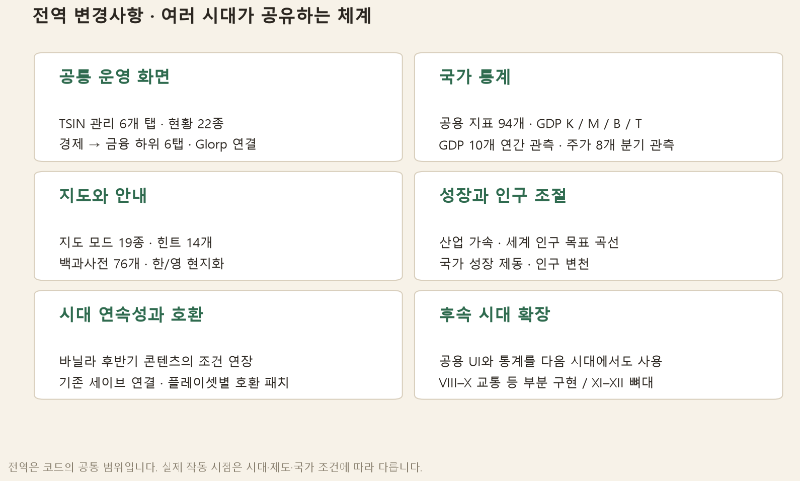
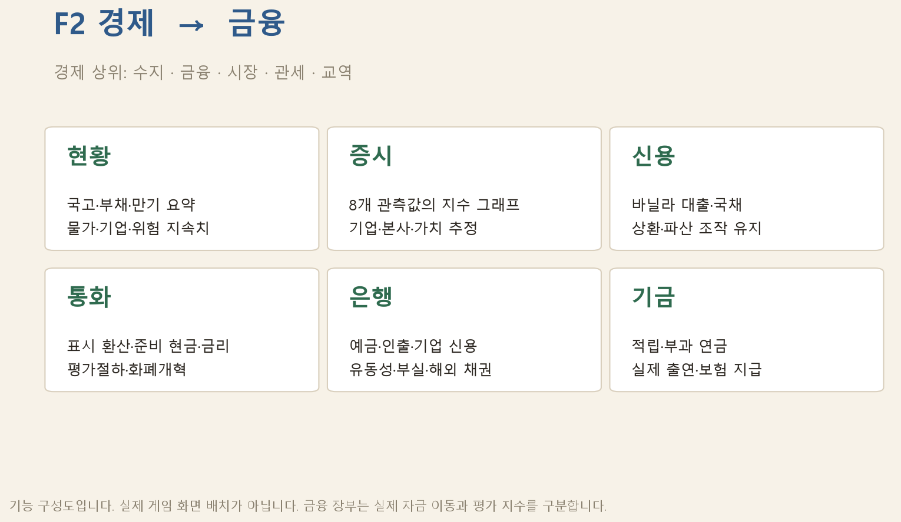
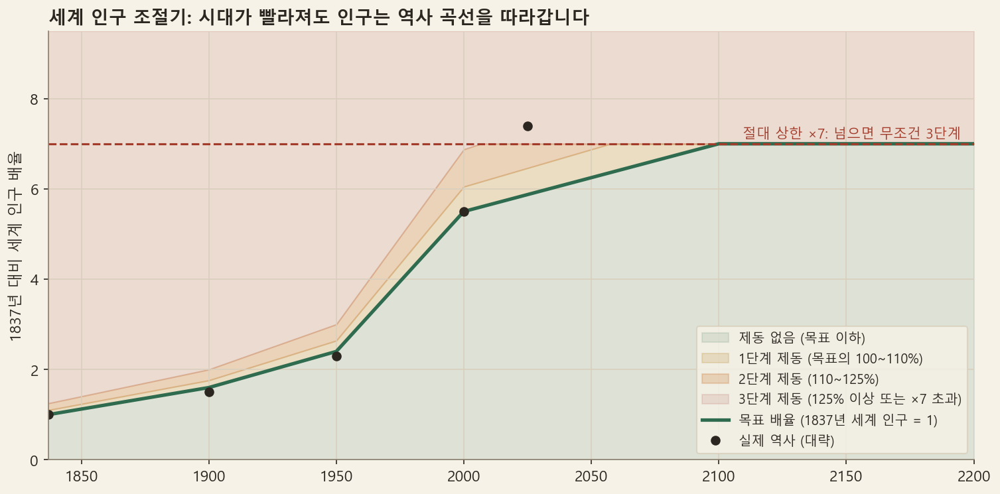
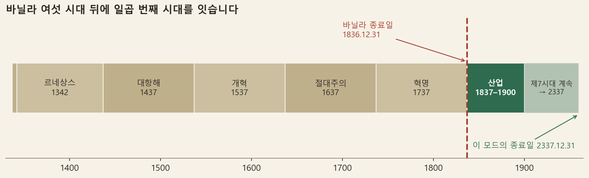
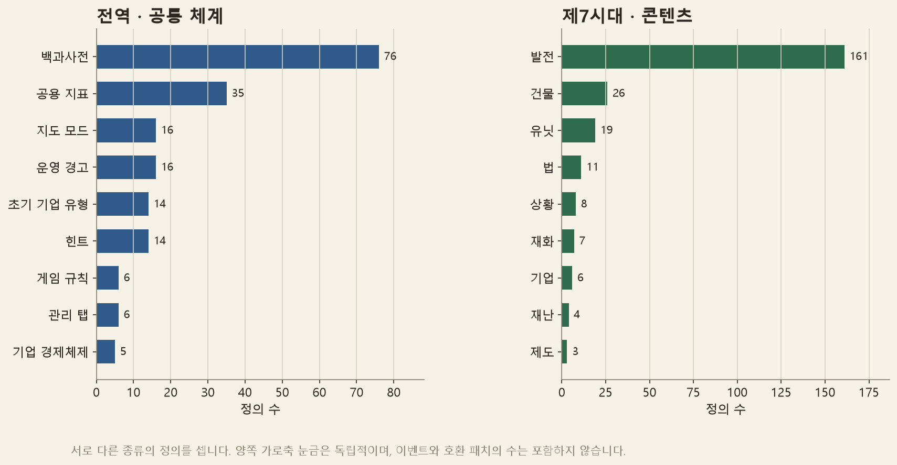
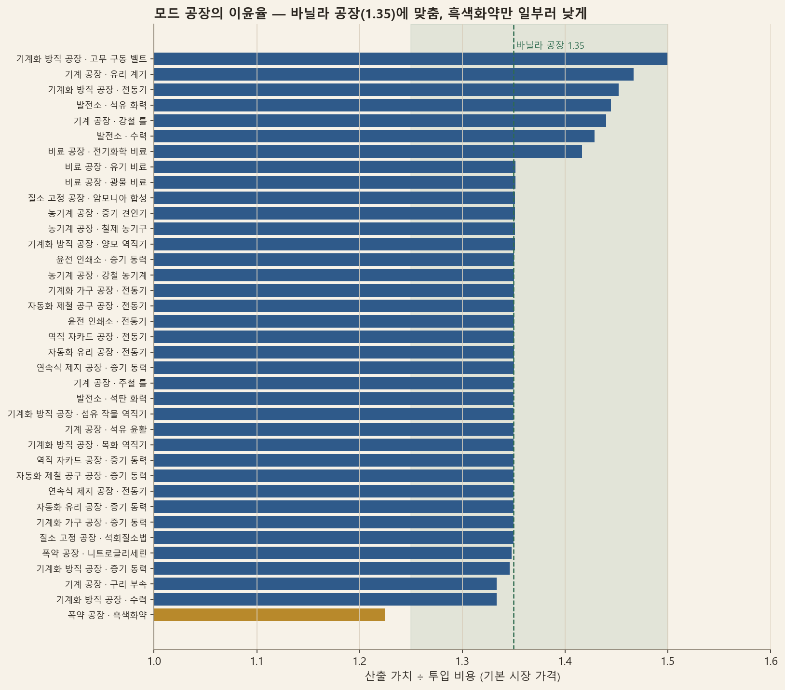
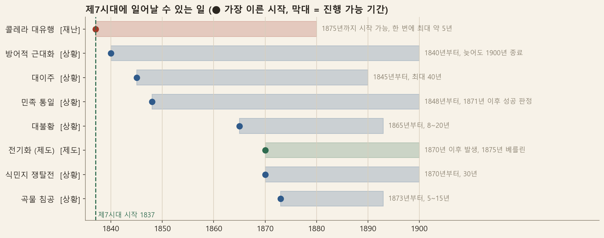
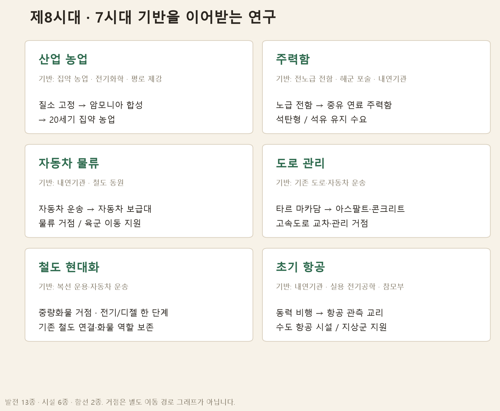

  

**특이점이 온다**는 Europa Universalis V의 기존 캠페인에 산업화와 이후 시대를 이어 붙이는 확장 모드입니다. 제7시대 「산업」의 공장·교육·사회운동·정치를 중심으로, 여러 시대가 공유하는 기업·금융·역사 진행 체계를 추가합니다. 제8시대는 농업·함선·자동차 물류·초기 항공 지원까지 부분 구현했고, 제9~12시대는 시대 정의를 등록한 상태입니다. 게임 종료일은 **2337년 12월 31일**입니다.

현재 버전은 **0.7.0 개발 빌드**입니다. 코드 구현과 정적 검사를 마친 기능에도 인게임 표시·장기 밸런스·세이브 재로드 검증이 남아 있습니다. 아래 이미지는 실제 게임 화면을 촬영한 것이 아니라 현재 정의와 설계 범위를 설명하는 도표입니다.

## 목차

1. [전역 변경사항](#global-systems)
2. [시대별 콘텐츠](#era-content)
3. [설치·호환성·기존 세이브](#installation)
4. [개발과 검증](#development)
5. [남은 개발 범위](#roadmap)
6. [English summary](#english-summary)

<a id="global-systems"></a>

## 1. 전역 변경사항

전역은 여러 시대가 공유하는 코드와 화면을 뜻합니다. 모든 기능이 1337년부터 무조건 작동하는 것은 아닙니다. 각 기능은 시대·기술·제도·국가 상태에 맞춰 열리며, 산업 가속과 주요 연간 통계는 7시대 이후의 진행에 연결됩니다.



### TSIN 관리와 운영 현황

좌하단 **TSIN 관리** 버튼은 국가 통계·경제·인구와 사회·기업과 금융·위기와 정책·과학기술의 6개 탭을 엽니다. 공용 지표 35개, 상태 카드 16개, 기본 화면·지도 연결 10개를 제공합니다. 버튼 묶음과 관리창은 이동할 수 있습니다.

GDP는 **K·M·B·T** 단위로 표시하며 최근 10개 연간 관측치를 그래프로 보여 줍니다. GDP는 생산 기반의 추정 지표이며 국고나 실제 국민계정과는 구분합니다. 교육은 문해율 → 중등교육 → 고등교육으로 이어지고 현재치와 목표치를 따로 표시합니다. 집계 전인 값은 미관측으로 남습니다.

옆의 **현황** 버튼은 운영 경고 **22종**을 모읍니다. 상품 가격·투입재·전력·고용·시장 접근성·군대 식량·인력·유지 수준·함대 소모·기아·과밀·교육·보조금·재정·주가와 금융 장부를 확인합니다. 상황과 재앙은 기존 상단 리본을 유지합니다. 상세 집계는 플레이어 국가에 대해 분기마다 수행하고 수동 점검은 게임 1일 1회로 제한합니다. 경고 종류는 우클릭으로 숨겼다가 복원할 수 있습니다.

[관리창 구조](docs/dashboard_framework.md) · [운영 경고](docs/operational_alerts.md) · [경제 통계](docs/economic_statistics.md) · [교육](docs/education.md)

### F2 경제 안의 금융

**F2는 경제 패널 그대로입니다.** 경제 상위 탭은 수지·금융·시장·관세·교역이며, 금융을 선택하면 아래 6개 하위 탭이 나타납니다. 기존 생산 패널이나 F3~F9 단축키를 밀어내지 않습니다.



| 금융 하위 탭 | 표시·조작 |
|---|---|
| 현황 | 국고·부채·차입 지급액·물가·기업 수·위험 지속치, 국가 대출의 만기 요약 |
| 증시 | 최근 8개 관측값의 주가 지수 그래프, 기업 카드·본사·관련 건물·가치 추정 |
| 신용 | 기존 바닐라 대출·채권·상환·파산 화면과 조작 |
| 통화 | 국별 표시 단위·환산율·준비 현금·정책금리·평가절하·화폐개혁·태환 정지 |
| 은행 | 합산 은행 현금·예금·인출·대출·유동성·부실 조정·해외 기업 신용 |
| 기금 | 적립·부과 방식 연금, 출연·지급·보험 청구와 기금 잔액 |

현황은 스크롤할 수 있습니다. 국가 부채 요약은 매월 바닐라 계약의 **잔여 원금**을 읽어 국채, 향후 1~12개월 만기 대출, 만기 도래·경과 대출을 구분합니다. 국채를 만기 경과 대출로 세지 않으며, 만기가 지났다는 사실만으로 채무불이행을 확정하지 않습니다. 부채 비율의 분모는 현재 월 조세·교역 수입×12이고 실제 연간 결산은 아닙니다.

은행·기업·보험·연금은 **실제 출연된 자금**을 사용합니다. 국고나 시민 계층의 현금을 차감해 출자·예금을 만들고 대출·이자·상환·배당·급여를 장부 사이에서 이동합니다. 주가 지수나 GDP 추정치를 현금으로 지급하지 않으며 기존 국가 대출에 이자를 다시 청구하지 않습니다.

- 기업 증자는 지분 희석을 반영하고, 회사채는 36개월 만기·연 4% 이자를 기록합니다.
- 은행은 기존 예금의 20%를 남겨야 신규 대출할 수 있습니다. 인출 미지급과 순자산 부족이 지속되면 신용 위축이 발생하며 실제 자금으로 회복해야 합니다.
- 해외 기업 신용은 여러 계약을 동시에 유지합니다. 12개월·60개월 계약마다 발행 금리·통화 원금·만기·지급 주기·연체를 따로 저장하고 12개월 간격으로 발행합니다. 국내 기업 대출과 회사채도 금리·만기가 다른 계약을 합산하지 않습니다.
- 연금은 적립금 지급과 실제 시민 자금으로 지급하는 부과 방식을 제공합니다. 보험은 조건을 만족하는 연체기에 한 번만 청구됩니다. 고령 인구별 수급권을 계산하는 모형은 아닙니다.

합병 유형과 관계없이 **국가 자산·국가 채무 승계, 민간 자산·부채 보존, 계약 연속성**을 기본값으로 처리합니다. 준비 일지에 국고와 장부를 기록하고 합병 확인 후 인도하며 중복 콜백과 취소된 준비를 처리합니다. 원래 대출 객체의 당사자를 변경하고 여러 계약의 금리·만기를 유지합니다. 엔진 합병 전체의 원자적 롤백을 보장하는 기능은 아닙니다.

구형 회사채는 원래 만료 타이머를 유지합니다. 엔진이 합병 때 그 정보를 없애면 날짜를 만들어 내지 않고 은행 화면에 **만기 확인 필요**로 표시합니다. 신규 계약은 처음부터 만기 월을 저장합니다. [계약 원장·승계·구형 만기 처리](docs/finance_contracts.md).

통화는 **기준 두캇 위에 얹은 표시·채권 환산 모형**입니다. 역사 환율을 재현한 값이나 엔진의 다중통화 결제 체계로 해석하지 않습니다. 금본위 정책에서는 먼저 태환을 정지해야 평가절하할 수 있습니다. 10:1 화폐개혁은 환산율과 해당 외채·채권 액면을 함께 나누어 실질 가치를 보존합니다. 실물 금 상품 태환·통화동맹·개별 해외 지분 시장은 후속 개발 범위입니다.

[금융 장부와 지원 범위](docs/finance_ledger.md) · [금융·증시 UI](docs/stock_market_ui.md)

### 전 시대 기업과 금융위기

산업 기업 6종 외에 산업화 이전 조직 **14종**을 제공합니다. 범용 무역 상단·수공업·광업·농산물·해운·상업 은행과 국가 고유 동인도회사·미쓰이·송방·산 조르조·남해회사·미시시피 회사 등이 조건에 따라 열립니다. 초기 조직의 주가는 상업·신용 조직에 대한 평가를 추상화합니다.

기업·자본시장 체제는 **전통주의·중상주의·간섭주의·자유방임주의·국가자본주의**입니다. 자유방임은 정책상 기업 수 상한을 없애고 시민 자금으로 민간 진입·축소를 처리합니다. 이때 정부의 직접 설립·해산을 제한합니다. 다른 체제는 한도를 적용하며 이미 있는 초과 기업을 강제로 삭제하지 않습니다.

버블 붕괴는 과잉 진입의 연속 관측이나 심각한 과잉공급·저가 같은 조건을 요구합니다. 산업화 이전의 충격은 국지적입니다. **1900년 이후 세계 대공황**은 여러 독립 시장과 국가의 지속적인 실물 스트레스가 있어야 시작하며 25년 재발 대기시간을 둡니다. 1929년이라는 날짜만으로 재난을 강제하지 않습니다. 기존 바닐라 금융 사건 4개는 원래 선택·비용을 유지하며 주식시장 결과에 연결합니다.

[기업](docs/corporations.md) · [자본시장과 위기 조건](docs/capital_markets.md)

### 역사 진행·럭키네이션·국경 거래

러시아와 추가 **25개 역사 경로**를 관리합니다. 영국·독일·이탈리아·오스트리아-헝가리·미국·멕시코·무굴·청·일본·벨기에·그리스·루마니아·세르비아·불가리아와 남미 11개 경로입니다. 영국의 대상 권역은 **브리튼 제도+아일랜드**이며 해외 제국 영토는 포함하지 않습니다.

기본 규칙은 형성 지원입니다. 별도 **지원 및 영토 보완** 규칙에서만 조건부 핵심 영토 보완과 주도국 복원을 실행합니다. 필수 지점 하나라도 플레이어 또는 그 하위 종속국이 소유·점령하면 강제 보완을 막습니다. 전쟁·현재 수도·소유국이 사라지는 합산 이전도 보호하며, HEX 담당 경로에는 중복 개입을 피합니다. 복원은 문화·종교·현지 기반을 요구하고 횟수·간격을 제한합니다.

**역사 진행·국경 점검** 결단은 영토를 바꾸지 않는 진단입니다. 별도 AI 국경 거래는 1700년 이후 매도국당 10년 간격으로 보수적인 내륙 농촌 한 지점을 실제 자금으로 거래합니다. 수도·역사 수도·코어·항구·요새·시장 중심·주요 광물·형성 필수 도시는 자동 매각에서 제외합니다. 구매국에도 연결·문화·지불 능력을 요구합니다. 복잡한 돌출부 탐지나 여러 지점 묶음 거래까지 구현한 것은 아닙니다.

[역사 국가·복원·월경지 거래](docs/historical_nations.md) · [진단과 러시아 경로](docs/historical_progression.md)

### 성장·인구·지도·안내


7시대 기본 보정은 연구 +10%, 건설 +10%, 승급 +20%, 이주 +25%, 제도 확산 +20%입니다. 수용한 7시대 제도, 공장 일자리 비중, 표준시 채택으로 산업 가속 점수를 얻고 2·3·5점에서 단계가 올라갑니다. 위 그림은 기본 보정과 가속의 합입니다.



세계 인구 조절기는 1837년 세계 인구를 기준으로 1900년 ×1.6, 1950년 ×2.4, 2000년 ×5.5, 2100년 이후 ×7의 목표 곡선을 사용합니다. 실제 인구 예측이 아닌 게임 규칙입니다. 초과 수준에 따라 제동하며 ×7 이상에는 가장 강한 제동을 적용합니다. 국가별 급성장 제동·인구 변천·수용력 보정 상한도 함께 사용합니다.

지도 모드는 **16종**, 힌트는 **14개**, 백과사전 개념은 **76개**입니다. 산업화·투자·도시화·노동·전력·교육·자동화·기반 시설·주거·GDP·기업·농업 등을 지도에서 확인할 수 있습니다.

| 게임 규칙 | 선택 |
|---|---|
| 산업 시대 플레이버 이벤트 | 보통 / 적게 / 많이 / 끔 |
| 전기화 시기 | 역사적 / 자유 |
| 세계 인구 조절기 | 켬 / 끔 |
| 확률 입법 | 켬 / 끔 |
| 경제 통계 기록 | 끔 / 켬 |
| 관찰 측정 기록 | 끔 / 켬 |
| 역사 사건 빈도 | 보통 / 고밀도 / 끔 |
| 럭키네이션 | 형성 지원 / 지원 및 영토 보완 / 끔 |
| 국경 거래 | 켬 / 끔 |

[시간 압축과 인구](docs/tempo.md) · [백과사전](docs/encyclopedia.md)

<a id="era-content"></a>

## 2. 시대별 콘텐츠



| 시대 | 기간 | 현재 범위 |
|---|---|---|
| VII 산업 | 1837~1900 | 산업·교육·사회운동·정치·군사 콘텐츠 |
| VIII 대전 | 1900~1945 | 농업·함선·자동차 물류·초기 항공 지원 부분 구현 |
| IX 원자력 | 1945~1990 | 시대 정의·현지화·임시 그림 |
| X 정보화 | 1990~2035 | 시대 정의·현지화·임시 그림 |
| XI 인공지능 | 2035~2120 | 시대 정의·현지화·임시 그림 |
| XII 우주 개척 | 2120~2337 | 시대 정의·현지화·임시 그림 |

경계 연도는 다음 시대의 시작 연도입니다. 2200년은 성간문명이라는 장기 목표의 시점이며 새 시대 경계나 종료일이 아닙니다. 후속 시대는 기존 기본 규칙과 일부 자산을 이어받습니다. 세계 보급도에 따른 동적 시대 전환은 아직 구현하지 않았습니다.



### 제7시대: 산업

제도 **3종**, 발전 **159개**, 재화 **7종**, 건물 정의 **26종**, 유닛 **19종**, 법 **11종**, 상황 **8종**, 재난 **4종**을 제공합니다. 건물 정의 수는 그 시대의 원본 소속을 기준으로 셉니다. 질소 고정 공장처럼 원본은 7시대 모듈에 남고 실제 해금은 8시대 기술로 옮긴 항목도 있습니다.

#### 제도와 발전

| 제도 | 주요 해금 |
|---|---|
| 산업자본주의 | 공장·화학·기업·자동화·산업 투자 |
| 대중사회 | 교육 사다리·정치 운동·사회 개혁·확률 입법 |
| 전기화 | 전력·전동기 생산·도시 조명·후기 산업 기술 |

각 제도를 수용하면 관련 발전 줄기가 열립니다. 무료 특화는 30개 선택지를 10개 분기·2~4단계로 나누고 선행 연구를 연결합니다. 후기 기술은 긴 선행과 교차 선행으로 늦춥니다. **질소 고정·암모니아 합성은 현재 8시대 기술**이며 기존 집약 농업은 7시대에 유지합니다.


처음에는 **증기의 시대**를 연구하고 산업 시대 제도 지도에서 발생·확산을 확인하세요. 기계 공장·예비군 제도를 확보하고 기존 건물의 개축과 산업 가속 단계를 살펴보는 것이 출발점입니다. 1900년 선도국의 발전 60~80% 확보는 밸런스 목표이며 검증된 결과는 아닙니다.

#### 산업·농업·기반 시설

새 재화는 **기관·비료·폭약·고무·석유·전력·농기계**입니다. 생산 방식·건설·유지 수요에 사용하고, 산업화 이전부터 공급 없는 팝 수요를 만들지 않습니다. 기존 철강·석탄·철도 기반 위에 기계·화학·전력을 연결합니다.

| 분야 | 주요 시설·작동 |
|---|---|
| 공업·자동화 | 기계 공장, 기계화 방직, 제철 공구·유리·제지·가구·인쇄·자카드 개축 |
| 화학·채굴 | 비료·폭약, 시비 농지·발파 채굴장, 증기 제재소 |
| 농업 | 농기계 공장·기계화 농장, 8시대로 이어지는 질소 비료 |
| 전력·교통 | 발전소·도시 조명망·철도역·증기선 항만 |
| 행정·보건 | 도청·상하수도, 산업 장려·철도 건설·공중보건·도시 개조 |
| 주거·교육 | 노동자 연립주택→모범 주택, 공립 중등학교·연구 대학 |

개축 건물은 기존 건물을 묻는 조건에서도 인정하도록 연결합니다. 철도와 시장 접근성이 자동화 규모에 영향을 주며 산업 투자법에 따라 계층이 실제 자금으로 공장 건설에 참여합니다. 관세 동맹, 석유 탐사, 고무 붐, 수에즈·파나마 운하 결단도 포함합니다.



그림은 투입재·산출물의 **기준 가격**만 비교합니다. 임금·건물 유지비·실제 시장 가격을 반영한 순이익이 아닙니다. 일반 공장 방식은 주로 1.25~1.5 범위를 사용하고 흑색화약은 의도적으로 낮게 둡니다. 암모니아 합성 방식은 8시대 해금임을 구분했습니다.

[경제 사슬](docs/economy_chain.md) · [건물 개축 호환](docs/replaced_buildings.md) · [발전 트리](docs/tech_tree_age7.md)

#### 사회·정치·입법

노동 조건·불만, 자유주의·민족주의·노동·사회주의·여성 참정권·노예제 폐지 운동을 산업·교육·법과 연결합니다. 노동자 주거, 공제 조합·노동조합 승인 등의 특권, 중등·고등교육과 공중보건 정책을 제공합니다. 사회주의 세포와 제1인터내셔널·코뮌형 사건은 이후 정치 콘텐츠의 연결점입니다.

법 11종은 노동·복지·직접세·결사와 집회·토지 개혁·정교 관계·산업 투자·트러스트·화폐 본위·개척지 토지·노예무역을 다룹니다. 대중사회와 의회를 갖춘 국가는 확률 입법의 발의·분기 심의·논쟁을 거쳐 법을 바꿉니다. 성공 3회면 통과, 정체 3회면 폐기하며 철회할 수도 있습니다. 기존 의회와 연결하고 게임 규칙으로 끌 수 있습니다.


위 곡선은 매 심의 확률이 같다는 가정입니다. 실제 확률은 계층·운동·정책·논쟁에 따라 바뀌며 5~85%로 제한합니다. 정부 개혁 6종과 의회 의제 11개도 산업 행정·국가 통계·노동·사회보험 등에 연결됩니다.

[입법](docs/legislation.md) · [상황](docs/situations.md)

#### 역사 사건·상황·재난

모드 전체 TSIN 이벤트 정의는 **275개**이며 그중 7시대 원본은 **214개**입니다. 별도 역사 제작분 **24+43개**는 이 수에 이미 포함됩니다. 소재 수·파일 수·실제 팝업 횟수는 다른 단위입니다.

첫 제작분은 우편·합성 염료·작업복·활동사진 사건열과 생활·과학 단발 사건입니다. 두 번째는 노동 분쟁·군정 감사·악취와 물 관리·국경의 돼지 분쟁·기업 공시·해외 산업 시찰의 6개 사건열입니다. 실제 시설·고용·군대·재정·상대국을 확인하며, 비용 선택은 실행할 때도 지급 능력을 다시 검사합니다.

플레이어 추가 추첨 상한은 보통 **연 3회**, 고밀도 **6회**입니다. 조건을 만족해야 실제 사건이 나오며 같은 사건열은 한 해에 한 단계만 진행합니다. 기존 플레이버 예산은 별도입니다. 세계 전체에 원역사를 날짜대로 강제 재생하거나 기업 심사 사건 자체가 공황 조건을 만들어 내지 않습니다.



| 종류 | 콘텐츠 |
|---|---|
| 상황 8종 | 국민의 봄·방어적 근대화·대이주·민족 통일·대불황·식민지 쟁탈전·곡물 침공·만국박람회 |
| 재난 4종 | 콜레라 대유행·대기근·연방 분열 위기·천년왕국 대반란 |
| 세계·외교 | 산업/근대화 임무, 나일강·북서항로·북극 원정, 조약항·열강 협조·제네바 협약·이중 제국 타협 |
| 생활·문화 | 골드러시·개척지, 낭만주의 회화·사진·오페라·사실주의 소설과 과학 사건 |

콜레라는 별도 질병(`tsin_cholera_disease`)으로 전파·감염·인구 피해를 처리하며 기존 재앙은 방역 대응 화면으로 유지합니다. 도시 인구를 직접 삭제하던 효과는 제거했습니다. [설명](docs/cholera_ui.md)

도시 등급의 기본 RGO 규모 보너스를 촌락 +75%·소도시 +50%·도시 +30%·인구 10만 이상 도시 +20%·최상위 등급 0%로 조정했습니다. 기존 광산도시 추가 효과는 별도 합산됩니다. [설명](docs/rgo_rank_balance.md)

연표의 점은 **발생 가능한 연도 문턱**입니다. 자동 발생일·종료일·상황 지속 기간을 뜻하지 않습니다. 19세기 대불황과 1900년 이후 공용 세계 대공황은 별도 체계입니다.

[첫 제작분](docs/historical_events_wave1.md) · [두 번째 제작분](docs/historical_events_wave2.md)

#### 군사

군사 발전 29개와 유닛 19종을 제공합니다. 육군은 예비군·기마 경찰·전열 소총병·산병·후장포·기마 소총병·창기병·철도 보급대·기관총·볼트액션 보병·엽병·속사 포대, 해군은 철갑함·모니터함·어뢰정·증기 수송선·방호 순양함·구축함·전노급 전함으로 이어집니다. 군사 특화가 아닌 국가도 해당 유닛을 연구할 수 있습니다.

### 제8시대: 대전 — 부분 구현

현재는 기술 **9종**, 새 시설 **2종**, 새 함선 **2종**입니다. 전용 시대관·정당·총력전 체계를 완성한 상태는 아닙니다.



| 발전 | 주요 선행 | 해금·효과 |
|---|---|---|
| 질소 고정 | 집약 농업·전기화학 | 질소 고정 공장 |
| 암모니아 합성 | 질소 고정·평로 제강 | 암모니아 생산 방식·비료 산출 |
| 20세기 집약 농업 | 암모니아 합성·집약 농업 | 식량 생산 보정 |
| 노급 전함 | 전노급 전함·해군 포술 | 석탄 연료 노급 전함 |
| 중유 연료 주력함 | 노급 전함·내연기관 | 중유 연료 전함 |
| 자동차 운송 | 내연기관 | 자동차 물류 거점 |
| 자동차 보급대 | 자동차 운송·철도 동원 | 육군 이동 개선 |
| 동력 비행 | 내연기관·실용 전기공학 | 수도 항공 시설 |
| 항공 관측 교리 | 동력 비행·참모부 | 지상전 지휘 보정 |

군사·운송의 새 발전은 기존 산업자본주의·전기화 수용 조건을 재사용합니다. 자동차 물류 거점과 수도 항공 시설은 기관·석유·고무·도구를 소비합니다. 항공 시설은 수도 도시의 한 단계 시설이며, 항공은 기존 지상군의 연락·관측 지원으로 표현합니다. 별도 항공 유닛·공중전·폭격 엔진은 없습니다.

새 함선은 기존 전노급 함선을 바탕으로 별도 건조·수리·유지 수요를 갖습니다. 중유형은 석유를 지속 소비합니다. 기존 함대를 일괄 삭제하거나 강제 교체하지 않습니다. 농업 이관도 기존 연구 ID를 보존하며 7시대 집약 농업의 효과를 빼앗지 않습니다.

[8시대 연결](docs/age8_transport_military.md) · [농업·사회 상태 인계](docs/age8_handoff.md)

### 제9~12시대: 시대 뼈대

원자력은 핵 억지·국제 질서·대량소비, 정보화는 디지털 통신·세계 공급망, 인공지능은 자동화와 노동·통치 전환, 우주 개척은 지외 정착·우주 산업을 주제로 삼습니다. 현재는 이름·시작 연도·기본 규칙·현지화·임시 자산만 등록되어 있습니다. 전용 기술·생산 사슬·사건·새 제도나 실제 다행성 지도·성간 함대가 제공되는 것은 아닙니다.

<a id="installation"></a>

## 3. 설치·호환성·기존 세이브

1. 저장소를 `Documents/Paradox Interactive/Europa Universalis V/mod/The Singularity Is Near`에 둡니다.
2. **소스 저장소를 사용하는 경우** 모드 루트에서 `python tools/sync_eras.py`를 실행해 `era_7`·`era_8` 원본을 게임 경로에 배치합니다. 배포 사본은 이 작업이 반영된 상태입니다.
3. 런처 플레이셋에서 활성화합니다. Glorp를 사용하는 현재 로컬 구성은 **Glorp → TSIN → TSIN Playset Compat** 순서입니다. 호환 패치는 설치된 모드 버전에 맞춰 생성해야 합니다.
4. GUI·콘텐츠 변경을 실제 게임에 반영하려면 게임을 다시 실행합니다. 문제 보고에는 오류 로그와 활성 플레이셋을 함께 첨부하세요.

메타데이터의 지원 게임 버전은 **1.4.x**입니다. 시대·발전·defines나 같은 GUI를 바꾸는 다른 모드는 개별 충돌 검토가 필요합니다. Glorp 연동은 선택 사항이며, 창작마당 UI 원본은 메인 저장소에 재배포하지 않고 로컬 호환 패치로 처리합니다. HEX와도 단순히 로드 순서만 맞췄다고 모든 역사 처리의 호환을 보장하지 않습니다.

기존 후반 바닐라 콘텐츠의 시대 조건을 연장하는 연결 패치를 포함합니다. 그 패치가 있다는 사실과 후속 시대 전체의 콘텐츠 호환 완료는 구분합니다. TSIN 콘텐츠가 들어간 세이브에서 모드를 제거하지 마세요. 기존 연구 ID와 초기 자금 보존을 고려했지만 개발 중 업데이트의 모든 세이브 호환을 보장하지는 않습니다.

[호환성](docs/compat.md) · [바닐라 덮어쓰기](docs/overrides.md) · [배포](docs/release.md)

<a id="development"></a>

## 4. 개발과 검증

| 경로 | 역할 |
|---|---|
| `era_7/` | 7시대 편집 원본·manifest, 368개 등록 파일 |
| `era_8/` | 8시대 편집 원본·manifest, 11개 등록 파일 |
| `in_game/`·`main_menu/` | 전역 기능과 시대별 원본의 게임 실행용 파일 |
| `loading_screen/` | 종료일 등의 defines |
| `data/`·`ui/` | 시대·역사 국가·사건·관리 화면·경고의 원본 데이터 |
| `tools/` | 생성·동기화·정적/회귀 검사·배포 도구 |
| `docs/` | 체계별 설명·개발계획·구현 범위 |
| `readme_media/` | 이 문서의 설명 도표와 집계 JSON |

원본을 편집한 뒤 `python tools/sync_eras.py`로 동기화합니다. 실행용 미러만 고치면 다음 동기화에서 덮어쓰므로, 시대 소속은 각 manifest를 확인하세요. 전역 금융·통계·역사 진행은 공용 경로에 유지합니다. 배포 도구는 등록된 모든 시대를 동기화하고 게임 실행 경로만 내보냅니다.

```powershell
python -B tools/sync_eras.py --check
python -B tools/validate.py
python -B tools/audit.py
python -B -m unittest discover -s tools/tests
```

README 갱신 기준의 코드 검사 기록은 **회귀 125개 통과**, 전체 정적 검사 오류 0·경고 0, 별도 감사 오류 0·기존 경고 2입니다. 기본/Glorp 금융 생성물 14개와 시대 원본 379개의 실행 파일이 일치했습니다. 이는 인게임 검증 완료를 뜻하지 않습니다.

| 생성·분석 도구 | 역할 |
|---|---|
| `tools/gen_stock_market_ui.py` | 기본·Glorp 금융/증시 GUI 생성·비교 |
| `tools/gen_finance_ledger.py` | 공용 금융 장부·조작 생성 |
| `tools/gen_native_credit_profile.py` | 바닐라 국가 부채의 월간 만기 요약 |
| `tools/gen_historical_nations.py` | 역사 경로·복원·AI 국경 거래 |
| `tools/gen_historical_events_wave1.py`·`tools/gen_historical_events_wave2.py` | 역사 사건 제작분 생성 |
| `tools/gen_age8_transport_military.py` | 8시대 함선·물류·항공 지원 |
| `tools/gen_era_skeleton.py` | 후속 시대 정의·현지화·임시 자산 |
| `tools/gen_age7_patches.py`·`gen_playset_compat.py` | 시대 연결·플레이셋 호환 패치 |
| `tools/econ_report.py`·`observer_report.py` | 경제·관찰 로그 분석 |

README 도표는 `python tools/make_readme_media.py`로 재생성합니다. `matplotlib`·`Pillow`가 필요하고 `--output <폴더>`로 별도 검토 사본을 만들 수 있습니다. 개수는 원본에서 읽고 `readme_media/content_inventory.json`에 기록합니다. 금융·연구 연결 그림은 기능 개요이며 실제 게임 화면의 배치를 재현한 목업이 아닙니다.

<a id="roadmap"></a>

## 5. 남은 개발 범위

국가 합병의 금융 승계와 해외 다중 계약은 구현했습니다. 실제 엔진의 Loan 승계·구형 만기 보존은 인게임 검증 대상입니다. 개별 해외 지분·실물 금 태환·통화동맹·연령별 연금 수급권은 추가 개발 범위입니다. 역사 사건은 별도 제작분 67개를 추가했지만 180개 소재 전체나 800~1200개 이벤트 목표를 완료한 것은 아닙니다. 복잡한 국경 돌출부·묶음 거래도 후속 범위입니다.

8시대의 전용 3개 제도·정당·총력전과 9~12시대의 상세 기술·생산·정치 콘텐츠는 구체화된 계획부터 순차 개발합니다. **전선 중심 자동전투는 무기한 보류**입니다. 인게임 검증은 전체 구현 이후 진행하는 방침을 유지합니다.

[미래 개발계획과 구현 현황](docs/future_development_plan.md) · [중간커밋 이후 재개 기록](docs/resume_ac54046.md) · [변경 이력](docs/changelog.md)

## English summary

**The Singularity is Near** extends Europa Universalis V to **2337.12.31**, with age-VII industrial content, shared economic systems, partial age-VIII content and age-IX–XII scaffolds. Version **0.7.0** targets game **1.4.x** and remains a development build.

**Shared systems:** six-tab TSIN dashboard, 35 metrics, 22 operational warnings, 16 map modes, 14 hints and 76 encyclopedia concepts. GDP uses K/M/B/T formatting and ten annual observations. F2 remains Economy: Finance contains Overview, Stocks, Credit, Currency, Banks and Funds. Native loans, bonds, repayment and bankruptcy controls remain connected. Funded bank/company accounts, equity dilution, corporate bonds and pension/insurance payments use aggregate accounts. Loans retain separate contract IDs, rates, maturity and payment schedules. Annexation journals preserve treasury, liabilities and contract parties; they do not provide an engine-wide ACID rollback. Missing expiry data in legacy bonds is flagged for explicit repair rather than assigned a fabricated date. Currency is an accounting overlay on native ducats; physical gold redemption and a native multicurrency market are not implemented.

**Historical progression:** Russia plus 25 additional paths, guarded AI restoration and paid rural enclave sales. Britain is limited to the British Isles and Ireland. Human owners/controllers and their subjects are protected from forced core transfers. Two historical waves add 24+43 events, already included in the **275** total TSIN event definitions; era-VII sources contain 214 of them. Historical material counts are not event counts or guaranteed popup frequency.

**Age VII:** three institutions, 159 advances, seven goods, 26 building definitions, 19 units, 11 laws, eight situations and four disasters. **Age VIII:** nine advances, two facilities and two ships connect industrial agriculture, motor logistics, early aviation support and dreadnoughts. Dedicated political systems and institutions remain planned. **Ages IX–XII:** dated definitions, localization and placeholder art only.

Edit era sources under `era_7/` and `era_8/`; run `python tools/sync_eras.py` before launching a source checkout. Shared features retain their existing paths. Glorp integration uses a local compatibility mod. Latest code verification recorded 119 passing regressions and zero validation errors/warnings; runtime layout, long-term balance and save continuity still require in-game checks. README images are explanatory diagrams, not gameplay screenshots.


### 확장 개발 — 2026-11-16 진행 중

교육·언론 정책에 따른 국가 연구 속도 보너스와 시장 냉장 보관소·전기 냉동 보관소를 추가했습니다. 기술별 병렬 전파나 운송 중 부패는 계산하지 않습니다. 전기 냉동은 기존 냉장 시설의 업그레이드이며 전력 유지비를 소비합니다. 연구·건설 화면의 최종 표시와 실제 보존 효과는 인게임 검증 대기입니다. 나머지 확장 개발계획은 아직 구현 완료가 아닙니다. [실행 기록](docs/expansion_execution_2026_11_16.md)
