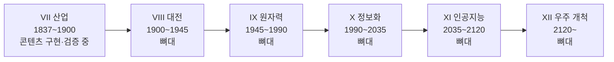
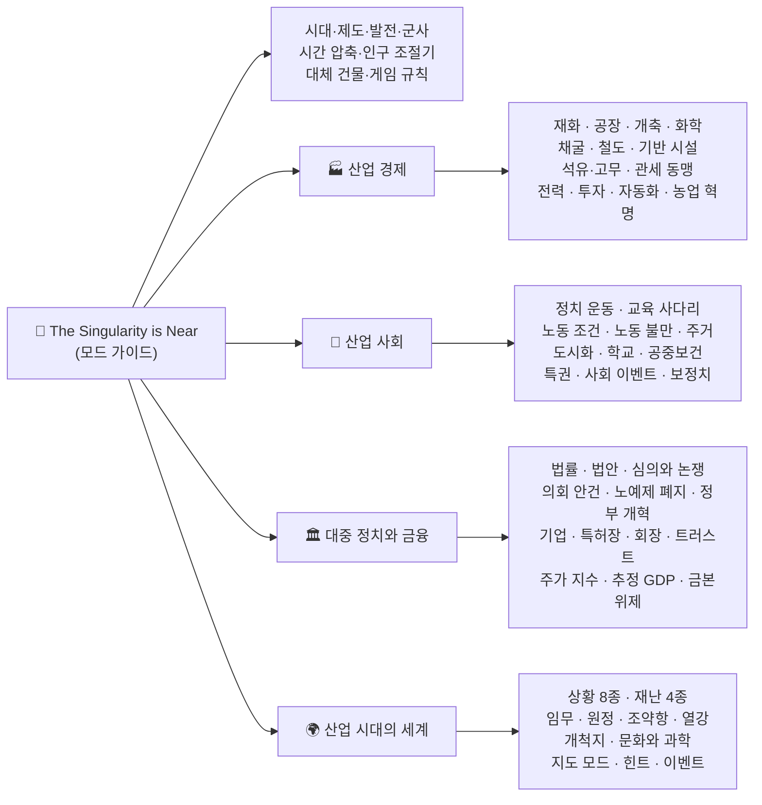
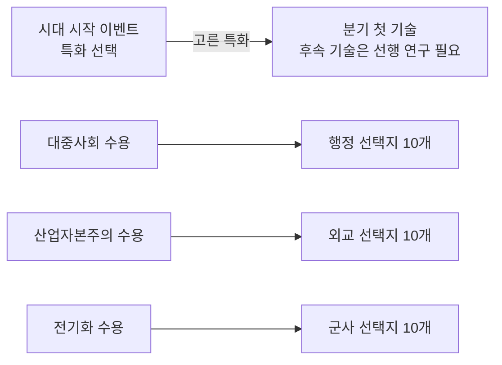
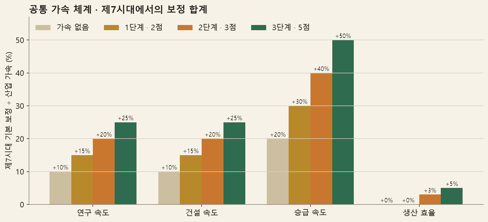
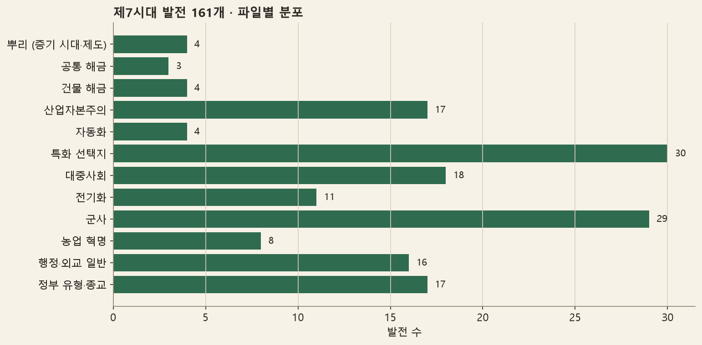
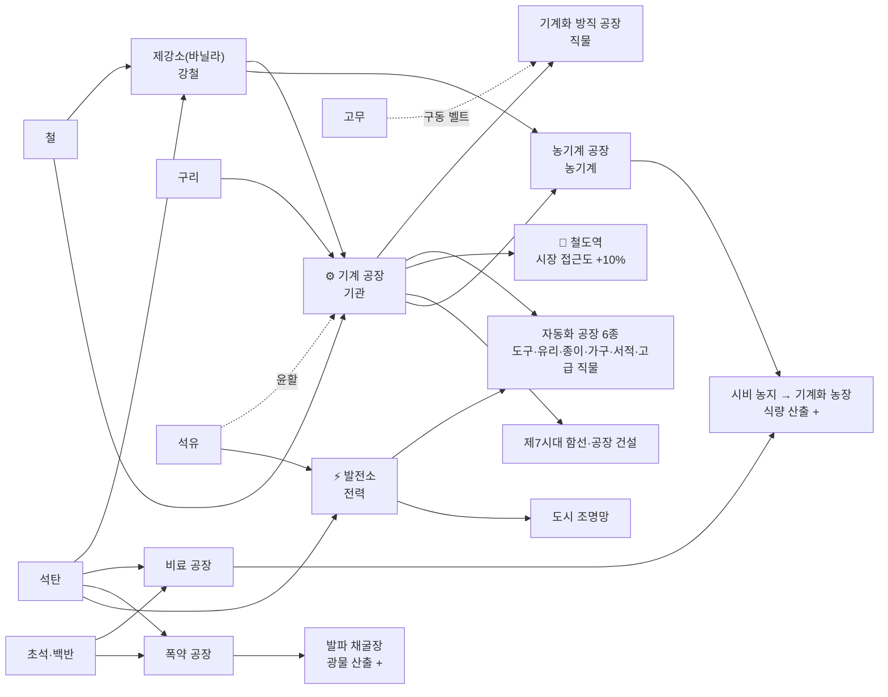
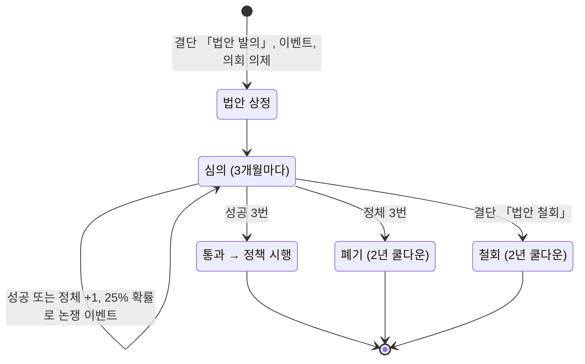
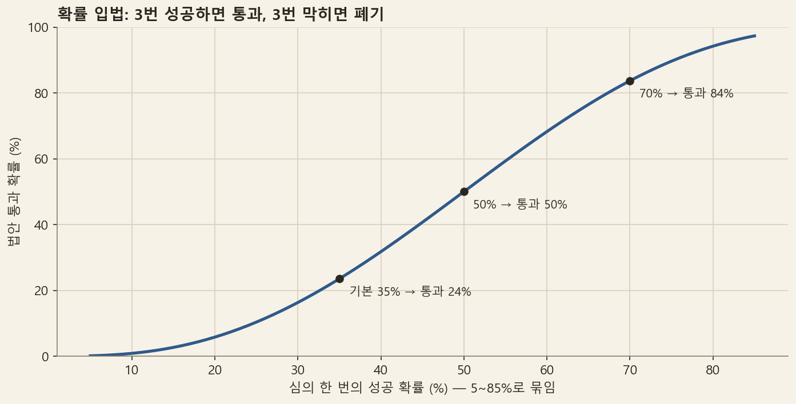

<p align="center">
  
</p>

<p align="center">
  
  
  
  
</p>

> **유로파 유니버설리스 5가 1836년에 끝날 필요는 없습니다.**
>
> The Singularity is Near(특이점이 온다)는 바닐라 여섯 시대 뒤에 **제7시대 「산업」(1837~1900)의 콘텐츠**와 **제8~12시대의 뼈대**를 더하고, 게임 종료일을 **2337년**까지 늘리는 확장 모드입니다. 현재 실제 콘텐츠 개발 범위는 제7시대이며, 이후 시대는 이름·시작 연도·기본 규칙·현지화만 등록되어 있습니다.

> [!WARNING]
> 0.7.0은 **인게임 검증 중인 개발 빌드**입니다. 일부 기능은 플레이에서 확인했지만, 새 관리 UI와 제8~12시대 전환은 추가 검증이 필요합니다. 제8~12시대의 전용 기술·시대관·이벤트·새 밸런스는 아직 구현하지 않았습니다.

---

## 목차

1. [이 모드가 하는 일](#1-이-모드가-하는-일)
2. [한눈에 보기](#2-한눈에-보기)
3. [처음 하는 사람을 위한 안내](#3-처음-하는-사람을-위한-안내)
4. [시대와 제도](#4-시대와-제도)
5. [시간 압축과 세계 인구 조절기](#5-시간-압축과-세계-인구-조절기)
6. [발전 트리](#6-발전-트리)
7. [산업 경제](#7-산업-경제)
8. [산업 사회](#8-산업-사회)
9. [대중 정치와 금융](#9-대중-정치와-금융)
10. [산업 시대의 세계](#10-산업-시대의-세계)
11. [군사](#11-군사)
12. [인터페이스와 게임 규칙](#12-인터페이스와-게임-규칙)
13. [바닐라와의 연속성, 호환성, 세이브](#13-바닐라와의-연속성-호환성-세이브)
14. [설치](#14-설치)
15. [개발자용 안내](#15-개발자용-안내)
16. [앞으로의 계획](#16-앞으로의-계획)
17. [English summary](#english-summary)

---

## 1. 이 모드가 하는 일



바닐라 EU5는 1337년에 시작해 여섯 시대(전통, 르네상스, 대항해, 개혁, 절대주의, 혁명)를 지나 **1836년 12월 31일**에 끝납니다. 이 모드는 그 뒤에 제7~12시대를 잇습니다. 콘텐츠가 있는 제7시대와 이후 시대 뼈대는 구분해서 개발합니다.

| | 바닐라 | 이 모드 |
|---|---|---|
| 등록된 마지막 시대 | 제6시대 「혁명」 (1737~) | **제12시대 「우주 개척」 (2120~, 뼈대)** |
| 실제 콘텐츠 개발 범위 | 제1~6시대 | **제7시대 「산업」** |
| 종료일 | 1836.12.31 | **2337.12.31** |
| 새 제도 | — | 산업자본주의, 대중사회, 전기화 |
| 제6시대 콘텐츠 | 1837년에 끝남 | 제국주의·민족주의 전쟁명분, 혁명, 의회 안건 등이 제7시대에도 이어짐 |

설계 원칙은 세 가지입니다.

- **나라 태그 조건을 쓰지 않습니다.** 영국, 프로이센, 일본 같은 특정 나라를 위한 스크립트가 아니라, 조건(산업화 정도, 노예제, 정부 형태, 인구 등)을 만족하는 어느 나라에서나 같은 일이 일어납니다.
- **바닐라 방식을 따릅니다.** 상황, 재난, 의회 의제, 계층 특권, 백과사전, 힌트, 지도 모드 모두 바닐라와 같은 구조로 만들었습니다.
- **빨라진 만큼 상한을 둡니다.** 산업화로 한 해에 일어나는 변화가 커지지만, 세계 인구 조절기가 인구를 역사 곡선에 묶어 둡니다.

## 2. 한눈에 보기

<p align="center"></p>

| 분야 | 주요 내용 |
|---|---|
| 시대 | 제7시대 「산업」, 시대 보정치와 팝 수요, 산업 가속 3단계, 세계 인구 조절기 |
| 제도 | 산업자본주의, 대중사회, 전기화 (1870년 이후) |
| 발전 | 161개 (특화 선택지 30개, 군사 29개, 정부 유형·종교 17개 포함) |
| 경제 | 재화 7종, 건물 26종(바닐라·모드 건물을 개축하는 15종 포함), 자동화, 철도와 시장 접근도, 화학 공업, 전력, 농업 혁명, 석유와 고무 |
| 사회 | 정치 운동 5종과 노예제 폐지 운동, 노동 조건과 불만, 주거, 교육 사다리, 공중보건 |
| 정치·금융 | 법 11종, 확률 입법(법안), 의회 의제 11개, 정부 개혁 6종, 기업 6종과 주가 지수, 추정 GDP, 금본위제 |
| 세계 | 상황 8종, 재난 4종, 임무 팩 2종, 원정 3종, 조약항 평화 조약, 관세 동맹, 열강 이벤트, 골드러시 |
| 군사 | 유닛 19종 (육군 12, 해군 7) |
| 인터페이스 | 지도 모드 16종, 힌트 14개, 백과사전 항목 76개, 게임 규칙 6종 |
| 이벤트 | 180개 |
| 현지화 | 영어·한국어 전체 (키 약 2,500개씩) |

## 3. 처음 하는 사람을 위한 안내

게임 안 백과사전에서 **"The Singularity is Near"** 항목을 열면 모드 전체 안내가 나옵니다. 모든 항목은 아래처럼 가이드 → 분야 허브 → 세부 항목으로 이어지고, 모드 객체(건물, 법, 결단 등)의 툴팁에서도 `[개념]` 링크로 바로 열 수 있습니다.



**1837년에 처음 할 일**

1. 시대가 시작될 때 나오는 안내 이벤트를 읽습니다. 지금 열린 특화 발전과 나중에 열릴 특화 발전을 알려 줍니다.
2. **증기의 시대** 발전부터 연구합니다. 모든 나라에 열려 있는 제7시대 트리의 뿌리입니다.
3. **산업 시대 제도** 지도 모드로 새 제도가 어디에 생겼는지 확인하고, 되도록 빨리 수용합니다.
4. **예비군 제도** 발전으로 징집군이 이웃 나라에 뒤처지지 않게 합니다.
5. **기계 공장** 발전으로 첫 공장을 열고, 옛 건물을 새 건물로 개축합니다.
6. 국가 보정치에서 **산업 가속** 단계를 확인합니다. 산업화가 얼마나 빨라졌는지 보여 줍니다.

## 4. 시대와 제도

### 전체 시대 구분과 현재 구현 상태

| 시대 | 기간 | 컨셉 | 구현 상태 |
|---|---|---|---|
| VII 산업 | 1837~1900 | 공장·도시·국민국가·전기화 | 콘텐츠 구현, 인게임 검증 중 |
| VIII 대전 | 1900~1945 | 대중 동원·총력전·제국 질서 재편 | 시대 뼈대만 |
| IX 원자력 | 1945~1990 | 핵 억지·국제 질서·대량소비 | 시대 뼈대만 |
| X 정보화 | 1990~2035 | 네트워크·세계 공급망·지식경제 | 시대 뼈대만 |
| XI 인공지능 | 2035~2120 | 지능형 자동화·노동과 통치의 전환 | 시대 뼈대만 |
| XII 우주 개척 | 2120~2200 이후 | 지외 정착·우주 산업·성간문명 | 시대 뼈대만 |

경계 연도는 다음 시대의 시작 연도입니다. 우주 개척의 2200년은 장기 개발 목표이며 새 시대 경계나 게임 종료일이 아닙니다. 기존 **2337.12.31 종료일은 유지**합니다.

현재 전환 기준은 시대 정의의 시작 연도입니다. 세계적 보급 조건에 따른 동적 전환은 아직 구현하지 않았습니다. 후속 시대는 7시대의 경제·수요·기본 수치를 임시로 이어받으며, 전용 기술·이벤트·시대관과 새 시대 보너스를 추가하지 않았습니다. 아이콘과 기술 화면 배경은 기존 7시대 이미지를 수정 없이 임시 재사용합니다.

시대 등록 원본은 [`data/eras.json`](data/eras.json), 생성기는 [`tools/gen_era_skeleton.py`](tools/gen_era_skeleton.py)입니다. 정확한 ID와 검증 절차는 [`docs/future_era_skeleton.md`](docs/future_era_skeleton.md)에 있습니다.


### 새 제도 3종

| 제도 | 목표 발생 시기 | 여는 것 |
|---|---|---|
| **산업자본주의** | 1840~1850 | 공장, 철도, 화학 공업, 기업, 자동화. 외교 특화 선택지를 엶 |
| **대중사회** | 1848~1860 | 정치 운동, 교육 사다리, 주거, 확률 입법. 행정 특화 선택지를 엶 |
| **전기화** | 1875~1885 (1870년 전에는 생기지 않음) | 발전소와 전력, 전동기, 도시 조명. 군사 특화 선택지를 엶 |

전기화의 발생 시기는 게임 규칙 **전기화 시기**(역사적 / 자유)로 바꿀 수 있습니다. 역사적 규칙에서는 1875년 이후 베를린에도 생깁니다. 세 제도에는 발상지 보정치가 있습니다.

### 특화 선택지를 모두 열기

바닐라는 시대 시작 때 고른 특화(행정·외교·군사) 하나의 선택지만 보여 줍니다. 제7시대에는 고른 특화의 첫 단계가 바로 열리고, 나머지 둘은 짝이 되는 제도를 수용하면 열립니다. 특화 기술 30개는 총 10개 분기·2~4단계이며 후속 기술에는 선행 기술이 필요합니다.



## 5. 시간 압축과 세계 인구 조절기

게임의 하루는 엔진에 고정되어 있어 건드리지 않습니다. 대신 **같은 시간에 더 큰 변화**가 일어나게 하고, 그만큼 상한을 둡니다.

### 산업 가속

<p align="center"></p>

제7시대 자체가 연구 +10%, 건설 +10%, 승급 +20%, 이주 +25%, 제도 확산 +20%를 줍니다. 여기에 나라마다 매년 **산업 가속 점수**를 매겨 단계 보정치를 더합니다.

| 점수 출처 | 점수 |
|---|---|
| 제7시대 제도 수용 (하나마다) | +1 (최대 3) |
| 공장 일자리 비중 8% 이상 / 20% 이상 | +1 / +1 더 |
| 표준시 채택 결단 | +1 |

2점이면 1단계, 3점이면 2단계, 5점이면 3단계입니다. 2단계 이상이고 인구 제동이 없으면 **산업 인구 붐**(인구 증가 +)도 붙습니다.

### 세계 인구 조절기

<p align="center"></p>

1837년 세계 인구를 기준(=1)으로 잡고, 연도별 목표 배율(1900년 ×1.6, 1950년 ×2.4, 2000년 ×5.5, 2100년 이후 ×7)과 비교해 매년 제동 단계를 정합니다. 목표를 넘을수록 모든 나라에 인구 증가 −, 식량 소비 +, 인구 수용력 − 보정치가 강해지고, 1837년의 7배를 넘으면 무조건 가장 센 제동이 걸립니다.

그 밖의 상한 장치:

- **국가 제동:** 한 나라의 연간 인구 증가율이 3%를 넘으면 1년간 증가 −, 이주 유출 +.
- **인구 변천:** 문해율과 도시화가 높은 나라는 출생이 줄어 증가세가 꺾입니다.
- **수용력 합계 관리:** 모드가 주는 인구 수용력 보정치의 합을 바닐라 대비 +80% 이내로 둡니다.
- **배출구:** 콜레라 대유행(재난)과 대이주(상황).

조절기는 게임 규칙 **세계 인구 조절기**로 끌 수 있습니다(시험·비교용).

## 6. 발전 트리

<p align="center"></p>

- 0.6의 74개에서 0.7의 **161개**로 늘었습니다. 바닐라 제6시대의 일반 발전(나라·문화 전용 제외)이 약 174개라 비슷한 규모입니다.
- 역사적으로 늦은 기술(속사포, 전노급 전함, 질소 고정)은 연도 조건 대신 **긴 선행 사슬과 교차 선행**(강철·전기)으로 늦춥니다.
- 정부 유형·종교 발전은 해당 나라에만 보입니다.
- 목표는 1900년 선도국이 제7시대 발전의 60~80%를 가진 상태입니다.

## 7. 산업 경제

### 새 재화 7종

| 재화 | 기본 가격 | 만드는 곳 / 얻는 법 | 쓰는 곳 |
|---|---|---|---|
| 기관 | 6 | 기계 공장 | 기계화 방직 공장, 자동화 공장, 철도역, 제7시대 함선·공장 건설 |
| 비료 | 2.5 | 비료 공장, 질소 고정 공장 | 시비 농지 → 기계화 농장 |
| 폭약 | 5 | 폭약 공장 | 발파 채굴장 |
| 고무 | 4 | 열대 밀림 (고무 붐 이벤트) | 기계화 방직 공장의 고무 구동 벨트 |
| 석유 | 4 | 석유 탐사 결단 (19세기 실제 유전 지역) | 기계 공장 윤활, 석유 화력 발전 |
| 전력 | 3 | 발전소 (석탄 / 수력 / 석유) | 전동기 단계의 공장, 도시 조명망. 운송비가 커서 대부분 같은 시장 안에서 씀 |
| 농기계 | 5 | 농기계 공장 | 기계화 농장 유지비 |

새 재화에는 팝 수요가 없습니다. 모두 생산 방식과 건설 수요로만 쓰여, 1337년부터 공급 없는 수요가 생기지 않습니다.

### 생산 사슬



### 새 건물 26종

<details>
<summary><b>건물 목록 펼치기</b> — 15종은 바닐라·모드 건물을 제자리에서 개축(obsolete)합니다</summary>

| 분야 | 건물 | 개축 대상 |
|---|---|---|
| 공업 | 기계 공장 | — |
| 공업 | 기계화 방직 공장 | 직물 방직소 |
| 자동화 | 자동화 제철 공구 공장 | 제철소 |
| 자동화 | 자동화 유리 공장 | 유리 제조소 |
| 자동화 | 연속식 제지 공장 | 제지소 |
| 자동화 | 기계화 가구 공장 | 가구 제조소 |
| 자동화 | 윤전 인쇄소 | 인쇄 공장 |
| 자동화 | 역직 자카드 공장 | 고급 옷감 제직소 |
| 화학 | 비료 공장 / 폭약 공장 | — |
| 화학 | 시비 농지 / 발파 채굴장 | — (농업·광업 강화 건물) |
| 채굴 | 증기 제재소 | 제재소 |
| 농업 | 농기계 공장 | — |
| 농업 | 기계화 농장 | 시비 농지 |
| 농업 | 질소 고정 공장 | 비료 공장 |
| 전력 | 발전소, 도시 조명망 | — |
| 교통 | 철도역 | — |
| 기반 시설 | 상하수도 | 수도교 체계 |
| 기반 시설 | 증기선 항만 | 해상군 기지 |
| 기반 시설 | 도청 | 지방 상서원 |
| 주거 | 노동자 연립주택 | — |
| 주거 | 모범 주택 | 노동자 연립주택 |
| 교육 | 공립 중등학교 | — |
| 교육 | 연구 대학 | 대학교 |

옛 건물을 묻는 바닐라·모드 조건(이벤트, 임무, 제도 발생 등)은 개축한 건물도 함께 셉니다(`docs/replaced_buildings.md`).

</details>

### 공장 수익

<p align="center"></p>

모든 공장 생산 방식은 기본 시장 가격에서 **산출 가치 ÷ 투입 비용**이 바닐라 공장과 같은 1.25~1.5 범위에 들도록 맞췄습니다. 흑색화약만 니트로글리세린보다 일부러 낮습니다. `tools/audit.py`가 이 범위를 검사합니다.

### 그 밖의 경제 체계

- **철도와 시장 접근도:** 수도와 철도로 이어진 도시에 철도역을 지으면 시장 접근도 +10%. 연결이 끊기면 철도역이 철거됩니다.
- **자동화와 시장 접근도 상한:** 자동화 공장은 산출이 커서, 시장 접근도가 0.75 미만인 도시에서는 최대 레벨이 바닐라 공장보다 더 줄어듭니다. 철도망이 사실상 자동화의 전제 조건입니다.
- **산업 투자:** 산업 투자법에 따라 계층이 자기 돈으로 공장을 짓습니다. 내각 행동 **산업 장려**, **철도 건설 촉진**이 있습니다.
- **농업 혁명:** 발전 8개, 농기계·기계화 농장·질소 고정, 그리고 값싼 신대륙 곡물이 밀려오는 **곡물 침공** 상황.
- **관세 동맹:** 산업자본주의를 수용한 나라가 만드는 국제기구. 회원끼리 서로 수입 관세를 면제하고(시장 병합의 근사), 최대 관세 −5%, 상인 영향력 +5%를 받습니다.
- **운하:** 수에즈·파나마 운하를 산업 공법으로 짓는 결단.

## 8. 산업 사회

### 정치 운동

바닐라의 운동(`movements`)은 종교나 문화에 묶여 있어 이념 운동을 표현할 수 없습니다. 그래서 나라마다 0~100의 운동 값을 두고 매년 갱신합니다. 60을 넘으면 선동 보정치가 붙고, 50 아래로 내려가야 떨어집니다.

| 운동 | 커지는 조건 (예) | 요구가 충족되면 | 60 이상일 때 |
|---|---|---|---|
| 자유주의 | 대중사회, 언론 자유, 집회 금지 | 결사의 자유 | 시민 만족 −, 자유주의 쪽 |
| 민족주의 | 대중 통신, 속국 신세, 호전적 가치관 | (상황·전쟁명분이 사용) | 인력 +, 호전 쪽 |
| 노동 운동 | 노동 운동 기술, 공장 지점 5곳 이상, 노동 규제 없음 | 공장법, 노동 보호 | 평민 만족 −, 생산 효율 − |
| 사회주의 | 노동 운동 50 이상, 공동체 가치관, 집회 금지 | 사회 보험 | 평민·시민 만족 −, 공동체 쪽 |
| 여성 참정권 | 보통 교육, 대중 통신, 인도주의 가치관 | (제7시대에는 없음) | 시민 만족 −, 인도주의 쪽 |
| 노예제 폐지 | 노예제가 남은 나라에서 매년 성장 | 노예무역 단속·노예제 금지 | 의회 의제 상정 (50 이상) |

집회를 금지하면 자유주의·사회주의는 오히려 커지고 노동 운동·여성 참정권은 지하로 숨습니다.

### 노동, 주거, 교육, 보건

- **노동 조건과 노동 불만:** 공장 지점마다 노동 조건 값이 있고, 나라의 노동 불만(0~100)이 매년 목표치로 다가갑니다. 불만이 높으면 파업과 노동 계급 이벤트가 늘고, 1885년 이후 사회주의 세포가 생깁니다.
- **주거:** 노동자 연립주택 → 모범 주택. 과밀은 콜레라와 대이주의 조건이 됩니다.
- **교육 사다리:** 문해율 → 중등교육률(공립 중등학교) → 고등교육률(연구 대학).
- **공중보건:** 상하수도, 내각 행동 **공중보건 운동**·**도시 개조**, 위생 관련 이벤트.
- **계층 특권 5종:** 상공회의소, 장교단 독점, 교회 학교망, 공제 조합, 노동조합 승인.

## 9. 대중 정치와 금융

### 법 11종

| 분야 | 법 |
|---|---|
| 사회 | 노동법, 복지법, 직접세, 결사·집회법, 토지 개혁, 교회와 국가 |
| 경제 | 산업 투자법, 트러스트, 화폐 본위(금본위제), 개척지 토지 |
| 노예제 | 노예무역 (노예제 폐지 압력과 해방) |

### 확률 입법

대중사회를 수용하고 의회가 있는 나라는 법(모드 법 11종과 바닐라 언론·교육·이민·노예제 법)을 **법안**으로만 바꿉니다. 바닐라 의회 판정은 그대로 두고, 그 앞에 심의 단계를 하나 더 둡니다.



<p align="center"></p>

심의 한 번의 성공 확률은 기본 35%에서 시작해, 법안을 지지하는 계층의 권력(+), 반대 계층의 권력(−), 관련 운동의 세기, 공화정, 입법 효율, 논쟁 결과로 오르내립니다(5~85%로 묶임). 툴팁에 항목별 내역이 나옵니다. 게임 규칙 **확률 입법**으로 끌 수 있습니다.

### 기업과 주가 지수

| 기업 | 여는 발전 | 회사 건물 |
|---|---|---|
| 제철 회사 | 전로 제강법 | 제강소, 제철소, 자동화 제철 공구 공장 |
| 기계 회사 | 기계 공장 | 기계 공장 |
| 방직 회사 | 기계화 방직 공장 | 직물 방직소, 기계화 방직 공장, 고급 옷감 제직소, 역직 자카드 공장 |
| 화학 회사 | 개량 비료 | 비료 공장, 질소 고정 공장, 폭약 공장 |
| 철도 회사 | 철도망 | 철도역 |
| 농기계 회사 | 기계 수확기 | 농기계 공장 |

- 회사를 세우면 회사 건물이 가장 많은 곳이 **본사**가 되고, **주가**(기준 100)가 분기마다 움직입니다. 나라의 **종합 주가 지수**는 과열과 폭락, 금본위제의 영향을 받습니다.
- **특허장**(독점·투자·산업 확장), **기업 회장**, **증권 보고서**, **식민 특허 회사**, **트러스트 법과 독점 금지**가 있습니다.
- **추정 GDP:** 나라마다 GDP, 1인당 GDP, 성장률을 추정해 지도 모드와 경제 통계 보고로 보여 줍니다. 정부 개혁 **국가 통계국**을 두면 보고서가 교육, 노동 불만, 주가, 기업 가치까지 담은 자세한 판으로 바뀝니다.

### 정부 개혁 6종과 의회 의제 11개

- 정부 개혁: 공장 감독관, 공무원 시험제, 국민 개병제, 철도 국유화, 국가 통계국, 국립 연구소.
- 의회 의제: 곡물법 폐지, 곡물 관세 보호, 노예제 폐지, 공장법 제정, 지주 권리 회복, 철도 회사 특허, 정교 협약 회복, 결사의 자유, 사회 보험 도입, 공장 감독 강화, 10시간 노동제. 의회 안건 **입법 회기**는 걸려 있는 법안의 심의를 돕습니다.

## 10. 산업 시대의 세계

<p align="center"></p>

### 상황 8종

| 상황 | 시작 | 내용 |
|---|---|---|
| 국민의 봄 | 운동이 강한 나라가 3곳 이상 | 바리케이드와 시가전, 헌법 / 진압 / 관망 (3년) |
| 방어적 근대화 | 1840년 이후 | 개항 압력을 받는 나라의 근대화 개혁 |
| 대이주 | 1845년 이후 | 과밀·기근의 나라에서 아메리카·오세아니아로의 이민 (최대 40년) |
| 민족 통일 | 1848년 이후 | 같은 문화군으로 나뉜 나라들의 통일 |
| 대불황 | 1865년 이후, 산업자본주의 국가 6곳 이상 | 공황 → 불황, 관세 인상이나 공공사업으로 회복 (8~20년) |
| 식민지 쟁탈전 | 1870년 이후, 열강 4곳 이상 | 식민 범위 확대, 식민 회의, 식민지 저항 (30년) |
| 곡물 침공 | 1873년 이후 | 값싼 수입 곡물과 농업 위기, 보호 관세 논쟁 (5~15년) |
| 만국박람회 | 결단으로 개최 | 기술 선도국이 개최, 방문국 연구 속도 + (1년, 5년마다 반복) |

### 재난 4종

| 재난 | 시작 조건 | 내용 |
|---|---|---|
| 콜레라 대유행 | 1830~1875년, 상하수도 없는 과밀 도시 2곳 이상 | 도시 인구 손실, 검역과 펌프 손잡이, 하수도 운동 |
| 대기근 | 병충해나 굶주림, 평민 불만 | 이민선과 퇴거, 곡물 수입 / 수출 지속 |
| 연방 분열 위기 | 노예제가 남은 공화국이 자유·노예 지역으로 갈라짐 | 남북전쟁형 위기 |
| 천년왕국 대반란 | 정체된 대농업 제국에 기근·개항 압력·종교 분열 | 태평천국·마흐디형 대반란 |

### 임무, 원정, 외교

- **임무 팩:** 「산업 국가로」, 「근대화 개혁」.
- **원정:** 나일강 수원 탐사, 북서항로 탐사, 북극점 도전.
- **조약항 개항** 평화 조약: 발전이 앞선 승전국이 패전국의 항구 하나를 30년간 개항시킵니다.
- **열강 협조 체제:** 열강 회의, 제네바 협약, 해군 경쟁 이벤트와 이중 제국 타협 결단.
- **골드러시와 개척지:** 골드러시 이벤트 사슬과 개척지 토지 법.
- **문화와 과학:** 예술 작품 4종(낭만주의 회화, 사진, 오페라, 사실주의 소설)과 과학·문화 이벤트.
- **다음 시대의 씨앗:** 제1인터내셔널, 무정부주의자 암살, 수도의 코뮌.

## 11. 군사

<details>
<summary><b>제7시대 유닛 19종 펼치기</b></summary>

| 육군 (12) | 해군 (7) |
|---|---|
| 예비군, 기마 경찰대, 전열 소총병, 소총 산병, 후장포대, 기마 소총병, 창기병, 철도 보급대, 기관총 분견대, 볼트액션 보병, 엽병, 속사 포대 | 철갑함, 모니터함, 어뢰정, 증기 수송선, 방호 순양함, 구축함, 전노급 전함 |

</details>

- 군사 발전 29개가 유닛과 군사 보정치를 엽니다. 군사 특화가 아닌 나라도 제7시대 유닛을 모두 연구할 수 있습니다.
- 제7시대 함선과 공장 건설에는 기관과 강철이 들어갑니다.
- 바닐라 제6시대의 전쟁 점수 유지(제국주의·민족주의 전쟁명분 등)는 제7시대에도 그대로입니다.

## 12. 인터페이스와 게임 규칙

### 독립 TSIN 관리창

왼쪽 아래 **TSIN 관리** 버튼에서 국가 통계·경제·인구와 사회·기업과 금융·위기와 정책·과학기술의 6개 탭을 엽니다. 창과 버튼 묶음은 이동할 수 있고, 현재 지표 35개·상태 카드 16개·기본 화면/지도 연결 10개를 제공합니다.

GDP는 K·M·B·T로 표시하고 최근 10개 연간 관측치를 그래프로 보여 줍니다. 중등·고등교육은 현재치와 목표치를 구분합니다. 미집계 값은 —로 표시하며, 기존 세이브의 실제 기준 연도는 다음 연간 집계 후 기록합니다. Glorp는 선택 사항이며 같은 공통 지표 정의를 사용합니다. 재실행 후 실제 화면 배치는 확인이 필요합니다.

이후 시대는 공통 창을 다시 만드는 대신 모듈과 지표 등록을 추가합니다. [`ui/dashboard_registry.json`](ui/dashboard_registry.json), [`docs/dashboard_framework.md`](docs/dashboard_framework.md)를 참고하십시오.


### 지도 모드 16종

| | | | |
|---|---|---|---|
| 산업 시대 제도 | 산업화 | 산업 투자 | 도시화 |
| 노동 불안 | 급진성 | 전력 | 교육 단계 |
| 자동화 | 공장 입지 | 근대 기반 시설 | 노동 조건 |
| 주거 | 1인당 추정 GDP | 기업 | 농업 혁명 |

### 운영 현황 버튼

기존 TSIN 관리 버튼 옆의 **현황** 버튼은 상품 가격·투입재·전력·적자·고용·시장 접근성·군대 식량·예비 인력·유지 수준·함대 소모·식량·과밀·교육 하락 압력·보조금 지원 적자·재정·주가의 운영 경고 16종을 모읍니다. 상황·재앙은 기존 상단 리본에 유지합니다.

배지 숫자는 표시 중인 경고 종류 수입니다. 기본 경고는 실시간으로 읽고, 상세 집계는 플레이어 국가에만 3개월마다 수행합니다. 수동 점검은 게임 1일 1회이며, 우클릭으로 유형을 이번 실행 동안 숨겼다가 복원할 수 있습니다. 상품 가격 기준과 보조금·충원 경고의 의미 등은 [`docs/operational_alerts.md`](docs/operational_alerts.md)에 설명되어 있습니다. 실제 UI와 판정은 재실행 후 검증이 필요합니다.

### 힌트 14개

상황 8종의 진행 알림과 함께, 발전소가 없을 때(전력), 조약항을 내줬을 때, 운동이 급진화했을 때, 노동 불만이 50을 넘었을 때, 첫 법안을 낼 수 있을 때, 주가가 폭락했을 때 힌트가 뜹니다.

### 게임 규칙 6종

| 규칙 | 선택지 |
|---|---|
| 산업 시대 플레이버 이벤트 | 보통 / 적게 / 많이 / 끔 |
| 전기화 시기 | 역사적 / 자유 |
| 세계 인구 조절기 | 켬 / 끔 |
| 확률 입법 | 켬 / 끔 |
| 경제 통계 기록 | 끔 / 켬 (매년 게임 로그에 `TSIN_ECON` 통계 줄, `tools/econ_report.py`로 분석) |
| 관찰 측정 기록 | 끔 / 켬 (관찰 실행 분석용) |

## 13. 바닐라와의 연속성, 호환성, 세이브

### 제6시대 콘텐츠가 제7시대에도 이어지게

바닐라에는 `current_age = age_6_revolutions` 같은 조건이 곳곳에 박혀 있어, 그대로 두면 1837년에 혁명, 제국주의 전쟁명분, 의회 안건 등이 멈춥니다. 이 모드는 그런 바닐라 객체를 생성기(`tools/gen_age7_patches.py`)로 복사해 제7시대 조건을 더한 뒤 객체 단위로 교체합니다(약 117개 객체, 42개 파일). 게임 패치가 나오면 생성기만 다시 돌리면 됩니다.

### 호환성

- 게임 버전 **1.4.x**.
- 시대, 발전, defines를 바꾸는 모드보다 **뒤에** 둡니다.
- 위의 바닐라 객체를 다른 모드도 바꾸면 이 모드의 정의가 쓰입니다. 플레이셋에 맞춘 로컬 호환 패치를 만드는 도구(`tools/gen_playset_compat.py`)가 있습니다(`docs/compat.md`).

### 세이브

- **이 모드로 진행한 세이브에서 모드를 끄지 마세요.** 세이브에 새 시대, 재화, 건물이 들어 있습니다.
- 기존 세이브에 켤 때는 1837년 전 세이브를 권합니다.
- 1.0 전까지는 업데이트가 진행 중인 세이브를 깰 수 있습니다.

## 14. 설치

1. 이 저장소를 내려받아 폴더 이름을 `The Singularity Is Near`로 하고 다음 위치에 둡니다.
   ```
   Documents/Paradox Interactive/Europa Universalis V/mod/The Singularity Is Near
   ```
2. 런처의 플레이셋에서 모드를 켭니다(시대·발전·defines를 바꾸는 모드보다 뒤).
3. 문제가 생기면 `Documents/Paradox Interactive/Europa Universalis V/logs/error.log`를 첨부해 이슈로 알려 주세요.

배포용 복사본(게임 파일만)은 `python tools/build_release.py`로 `tools/out/release/`에 만듭니다.

## 15. 개발자용 안내

```
in_game/         게임 스크립트 (시대, 발전, 건물, 이벤트, 상황, 재난, 법, 결단, 지도 모드, GUI …)
main_menu/       현지화(영어·한국어), 정적 보정치, 백과사전, 게임 규칙, 아이콘
loading_screen/  defines (종료일 등)
docs/            설계 문서 50여 개 (체계마다 하나, "사용자 확인 필요" 목록 포함)
tools/           검사·생성 도구 (Python)
readme_media/    이 README의 그림 (tools/make_readme_media.py로 생성)
```

| 도구 | 하는 일 |
|---|---|
| `tools/validate.py` | 문법, 참조, 읽는 순서, 이벤트 형식, 현지화, 백과사전 링크 검사 (오류 0이어야 함) |
| `tools/audit.py` | AI 가중치, 영어·한국어 짝, 공장 이윤율, 성능 위험 스코프 검사 |
| `tools/gen_age7_patches.py` | 제6시대 하드코딩 객체를 제7시대용으로 재생성 |
| `tools/gen_playset_compat.py` | 플레이셋별 로컬 호환 패치 생성 |
| `tools/observer_report.py`, `tools/econ_report.py` | 관찰 실행·경제 로그 분석 |
| `tools/make_readme_media.py` | README 그래프 재생성 |

주요 문서: [변경 이력](docs/changelog.md) · [시간 압축](docs/tempo.md) · [발전 트리](docs/tech_tree_age7.md) · [경제 사슬](docs/economy_chain.md) · [확률 입법](docs/legislation.md) · [기업](docs/corporations.md) · [상황](docs/situations.md) · [백과사전](docs/encyclopedia.md) · [바닐라 덮어쓰기](docs/overrides.md) · [호환성](docs/compat.md) · [용어집](docs/glossary.md)

## 16. 앞으로의 계획

1. 제7시대의 장기 진행·성능·밸런스와 새 공통 관리창을 인게임에서 검증합니다.
2. 이미 등록한 제8시대 「대전」에 총력동원·기계화·대중정치 콘텐츠를 개발합니다.
3. 제9시대 원자력 → 제10시대 정보화 → 제11시대 인공지능 → 제12시대 우주 개척 순으로 확장합니다.

후속 시대의 역사적 사건·새 시대관·기술은 설계안이며 아직 게임 객체로 추가하지 않았습니다. 7시대의 교육·사회운동·GDP·기업 데이터는 유지하고 이후 모듈이 이어받도록 합니다. 시대 뼈대만으로 1900년 이후의 완성된 현대전·정치·우주 시뮬레이션이 제공되는 것은 아닙니다.

---

## English summary

**The Singularity is Near** extends Europa Universalis V past its 1836 end date with playable industrialization content in **Age VII (1837–1900)** and **era scaffolds VIII–XII**, while keeping the game running until **2337**. It is the first step of a long-term project that follows humanity from the steam engine to the stars.

- **Three institutions:** Industrial Capitalism, Mass Society, Electrification (not before 1870).
- **161 advances**, all three specializations eventually open (each unlocked by its paired institution).
- **Industrial economy:** 7 goods (engines, fertilizer, explosives, rubber, oil, electricity, farm machinery), 26 buildings including 15 in-place upgrades of vanilla and mod buildings, automation, railways and market access, power stations, an agricultural revolution.
- **Time compression with caps:** stronger age modifiers and three industrial acceleration tiers, balanced by a world population governor that follows the historical curve.
- **Mass politics:** five political movements plus abolitionism, 11 laws, probability-based legislation (bills need three successful readings), corporations with share prices and a stock index, estimated GDP, the gold standard.
- **History without country tags:** 8 situations (Springtime of Nations, Long Depression, Scramble for Colonies, Great Migration, National Unification, Defensive Modernization, Grain Invasion, World Exhibitions), 4 disasters (Cholera, Great Hunger, Secession Crisis, Millenarian Rebellion), missions, expeditions, a treaty port peace treaty.
- **19 units**, 16 map modes, 14 hints, 76 encyclopedia entries, 6 game rules, 180 events. Full English and Korean localization.
- Vanilla age VI content (imperialism and nationalist casus belli, revolutions, parliament agendas) keeps working in the new age.

**Future-era scaffolds:** VIII World Wars (1900), IX Atomic Power (1945), X Information (1990), XI Artificial Intelligence (2035), XII Space Settlement (2120). They currently reuse age-VII defaults and placeholder art. No dedicated future advances, institutions, events or new balancing are implemented; 2200 is a project milestone, not the end date.

**Interface:** a standalone six-tab dashboard and optional Glorp adapter share registered metrics, compact K/M/B/T formatting and the ten-observation GDP history. Era and UI generators have check-only modes.

**Status:** 0.7.0 is a development build undergoing in-game verification. Some features have been tested; the latest dashboard and future-era transitions still require runtime checks. Do not remove the mod from a save that used it. Bug reports with `error.log` are welcome.

---

<sub>19세기 역사와 다른 패러독스 게임에서 착상을 얻었습니다. 다른 게임의 문구, 아이콘, 데이터는 복사하지 않았습니다. 그래프는 모두 모드 파일에서 생성했습니다.</sub>
